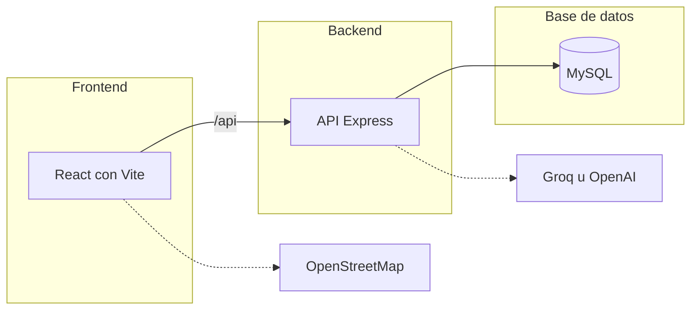

# Refugio Conectado

Plataforma web para la gestión de refugios de animales y la adopción responsable. Esta es la versión pública del proyecto, preparada como portfolio académico de la Tecnicatura Superior en Desarrollo de Software.

El objetivo es conectar a adoptantes, donantes y voluntarios con una o varias sedes, y dar a cada refugio un panel para administrar mascotas, solicitudes y el seguimiento posterior. Un superadministrador gestiona la plataforma completa.

Aplicación publicada: [https://refugio-conectado.vercel.app](https://refugio-conectado.vercel.app)

La interfaz está en español. Los datos iniciales de ejemplo corresponden a tres sedes de demostración en Córdoba, Argentina: Villa del Rosario, Pilar y Luque. Los correos y teléfonos de ejemplo no son datos reales.

## Funcionalidades

### Adopciones

- Catálogo público de mascotas, con búsqueda, filtros, ficha y historial médico visible.
- Solicitud de adopción para usuarios autenticados con rol de adoptante o voluntario.
- Revisión de solicitudes desde el panel del refugio.
- Seguimiento post-adopción para la persona adoptante y para el administrador de la sede.
- Favoritos y códigos QR que apuntan a la ficha pública de una mascota.

### Gestión de refugios

- Selector inicial de sede, con mapa de las sedes activas.
- Cada sede tiene un `slug` en la URL, por ejemplo `/villa-del-rosario/mascotas`.
- La API filtra los datos de esa sede con el encabezado `X-Refugio-Slug`.
- El backoffice global, en `/backoffice`, permite crear y editar sedes, zonas, administradores, usuarios, solicitudes de alta de refugios, organizaciones, convenios, estadísticas, auditoría y configuración.
- Los administradores de una sede se habilitan con una invitación de un solo uso que vence a las 48 horas.

### Panel administrativo de cada sede

En `/{slug}/admin` el administrador ve únicamente los datos de su refugio:

- Tablero con métricas y gráficos.
- Alertas de urgencia: mascotas con 90 días sin adopción, casos críticos a los 180 días, esterilización no registrada y vacunas o controles vencidos o próximos dentro de 15 días.
- Alta y edición de mascotas, imágenes e historial médico.
- Solicitudes, usuarios, donaciones, voluntarios y mensajes.
- Moderación de avisos de perdidos y encontrados, y publicación de novedades.

### Recomendador inteligente de mascotas

En `/{slug}/recomendador`, la asistente Luna conversa con la persona sobre vivienda, convivencia y preferencias. El backend prefiltra mascotas disponibles de esa sede con criterios de la base y, si hay un proveedor de IA configurado, el modelo ordena y explica las coincidencias.

Sin `GROQ_API_KEY` u `OPENAI_API_KEY`, ese chat responde que el asistente no está configurado.

El mismo recomendador tiene una versión independiente, orientada a automatización, en otro repositorio:

[https://github.com/EstefaniaRoggero/Recomendador-Inteligente-de-mascotas](https://github.com/EstefaniaRoggero/Recomendador-Inteligente-de-mascotas)

Ese proyecto no forma parte de este código. Acá el recomendador vive en la página del refugio y usa las mascotas cargadas en esta base.

### Asistente Luna

Luna también existe como asistente más amplio, distinto del chat de recomendación:

- En la web atiende consultas de adopción, donaciones, voluntariado, perdidos, novedades y seguimiento, y deriva al recomendador cuando hace falta un match.
- Puede usarse por WhatsApp si se configuran el token y el identificador de número de Meta. Si faltan, el webhook responde 404.
- El widget de la interfaz arma un enlace `wa.me` solo cuando hay un número público configurado.

### Otras funciones presentes en el código

- Registro local, inicio de sesión con contraseña para administradores y acceso con Google para adoptantes y voluntarios.
- Recuperación de contraseña.
- Donaciones registradas en la base con el método elegido. No hay una pasarela de pago externa.
- Voluntariado con calendario de turnos y formulario de contacto.
- Avisos públicos de perdidos y encontrados, sujetos a revisión del refugio.
- Novedades del refugio.
- Notificaciones dentro de la aplicación.
- Modo oscuro y diseño adaptable.
- Mapas con Leaflet y teselas de OpenStreetMap. La búsqueda manual de direcciones usa el servicio configurado en `VITE_GEOCODING_URL`.

## Tecnologías

Versiones declaradas en `frontend/package.json` y `backend/package.json`.

### Frontend

| Tecnología | Versión declarada | Uso en el proyecto |
|------------|-------------------|--------------------|
| React | 18.3 | Interfaz |
| React DOM | 18.3 | Renderizado |
| Vite | 5.4 | Desarrollo y build |
| React Router DOM | 6.26 | Rutas y sedes |
| Tailwind CSS | 3.4 | Estilos |
| Zustand | 4.5 | Sesión, tema y sede activa |
| Axios | 1.7 | Cliente HTTP |
| React Hook Form | 7.53 | Formularios |
| Framer Motion | 11.5 | Animación |
| Recharts | 2.12 | Gráficos del tablero |
| Leaflet y React Leaflet | 1.9 y 4.2 | Mapas |
| qrcode.react | 4.2 | QR de mascotas |
| SweetAlert2 | 11.14 | Avisos |
| Lucide React | 0.441 | Iconos |
| @react-oauth/google | 0.12 | Acceso con Google |

El empaquetado también usa `@vitejs/plugin-react`, PostCSS y Autoprefixer.

### Backend

| Tecnología | Versión declarada | Uso en el proyecto |
|------------|-------------------|--------------------|
| Node.js con módulos ES | — | Entorno de ejecución |
| Express | 4.21 | API REST |
| mysql2 | 3.11 | MySQL |
| jsonwebtoken | 9.0 | Sesiones JWT |
| bcryptjs | 2.4 | Contraseñas |
| google-auth-library | 9.15 | Verificación del token de Google |
| multer | 1.4 | Carga de imágenes |
| @vercel/blob | 2.8 | Imágenes persistentes si hay token de Blob |
| express-validator | 7.2 | Validación |
| helmet | 7.1 | Cabeceras de seguridad |
| cors | 2.8 | Origen permitido |
| compression | 1.8 | Respuestas comprimidas |
| express-rate-limit | 7.4 | Límite de solicitudes |
| morgan | 1.10 | Registro de peticiones |
| dotenv | 16.4 | Variables de entorno |
| openai | 6.42 | Cliente compatible con Groq y OpenAI |
| undici | 8.4 | Opciones de conexión del cliente de IA |
| nodemon | 3.1 | Recarga en desarrollo |

### Base de datos

MySQL, con scripts compatibles con el uso de MariaDB que documenta la prueba de integración. El esquema base está en `database/schema.sql`, con juego de caracteres `utf8mb4`. Al arrancar, el backend aplica migraciones de sedes, backoffice, seguimiento, turnos de voluntarios, WhatsApp, perdidos y novedades.

El diagrama de entidades de la versión base está en [`database/DIAGRAMA_ERD.md`](database/DIAGRAMA_ERD.md). Algunas tablas del sistema web se crean después, en esas migraciones.

## Arquitectura

El navegador carga una aplicación React. En desarrollo, Vite publica el frontend en `127.0.0.1:5173` y reenvía `/api` y `/uploads` al backend de Express en el puerto `5000`. Express consulta MySQL y, solo si hay una clave configurada, llama a Groq o a OpenAI. Los mapas se piden directo a OpenStreetMap.



Las rutas del frontend se cargan de forma diferida. El backend separa rutas, controladores, servicios y middlewares. El middleware de sede resuelve el refugio antes de la mayoría de los recursos.

## Estructura de carpetas

```
.
├── backend/
│   ├── config/           conexión, seed, migraciones y proveedor de IA
│   ├── constants/
│   ├── controllers/
│   ├── middlewares/      autenticación, sede, carga de archivos y errores
│   ├── routes/
│   ├── services/         recomendador, Luna, urgencias, seguimiento y WhatsApp
│   ├── tests/
│   │   ├── unit/
│   │   └── integracion/
│   ├── utils/
│   ├── uploads/          imágenes locales cuando no se usa Blob
│   ├── server.js
│   └── package.json
├── frontend/
│   ├── public/
│   └── src/
│       ├── components/
│       ├── constants/
│       ├── context/
│       ├── hooks/
│       ├── layouts/
│       ├── pages/        públicas, panel, administración y backoffice
│       ├── routes/
│       ├── services/
│       ├── styles/
│       └── utils/
├── database/
│   ├── schema.sql
│   ├── migration_*.sql
│   └── DIAGRAMA_ERD.md
└── README.md
```

## Requisitos

- Node.js con módulos ES y el ejecutor `node --test`. La suite se ejecutó con Node.js 22. `package.json` no fija una versión mínima.
- npm, incluido con Node.js.
- MySQL o MariaDB en local, con el cliente `mysql` disponible en la terminal.
- Un navegador actual.

Puertos usados en local:

| Servicio | Dirección |
|----------|-----------|
| Frontend | `http://127.0.0.1:5173` |
| API | `http://localhost:5000` |
| MySQL | `localhost:3306`, salvo que se cambie `DB_PORT` |

Google, Groq, OpenAI, WhatsApp y Vercel Blob son opcionales. La aplicación abre sin ellos. El recomendador y Luna necesitan una clave de IA. El acceso con Google necesita un Client ID.

## Instalación y ejecución local

Los comandos se ejecutan desde la raíz del repositorio. Hacen falta dos terminales, una para el backend y otra para el frontend.

### 1. Dependencias

```powershell
cd backend
npm install
cd ../frontend
npm install
```

### 2. Base de datos

Creá la base y las tablas iniciales:

```powershell
cmd /c "mysql -u root -p < database\schema.sql"
```

Ese script crea la base `refugio_conectado` si no existe. Pedirá la contraseña de MySQL en la terminal. No la guardes en el repositorio.

### 3. Variables de entorno

```powershell
Copy-Item backend\.env.example backend\.env
Copy-Item frontend\.env.example frontend\.env
```

Editá `backend/.env` y completá al menos la contraseña de MySQL y un `JWT_SECRET` aleatorio de 32 caracteres o más. Si el secreto falta, es corto o coincide con un valor de ejemplo, el backend no arranca.

En local, el frontend de ejemplo ya usa `VITE_API_URL=/api`. Vite reenvía esa ruta al puerto 5000, así que no hace falta una URL absoluta.

### 4. Datos de demostración

Con el backend configurado y `NODE_ENV` distinto de `production`:

```powershell
cd backend
npm run seed
```

El comando borra y vuelve a cargar datos de demostración: mascotas, historial médico, donaciones y mensajes de ejemplo. Muestra una sola vez, en esa terminal, las contraseñas de las cuentas locales de desarrollo. Si no definís `DEMO_ADMIN_PASSWORD` y `DEMO_USER_PASSWORD`, las genera al azar. El seed no se ejecuta cuando `NODE_ENV=production`.

Esas contraseñas no están escritas en este documento.

### 5. Arranque

Terminal del backend:

```powershell
cd backend
npm run dev
```

Al escuchar, la API aplica las migraciones pendientes. Comprobación: [http://localhost:5000/api/health](http://localhost:5000/api/health).

Terminal del frontend:

```powershell
cd frontend
npm run dev
```

Abrí [http://127.0.0.1:5173](http://127.0.0.1:5173). Vite está fijado a IPv4 y al puerto 5173.

El primer acceso global se crea si `SUPER_ADMIN_EMAIL` y `SUPER_ADMIN_PASSWORD` tienen valor al arrancar el backend. El ingreso es `/backoffice/login`.

Para un administrador de una sede existente también está `npm run create-admin` dentro de `backend`. El comando pide slug, correo y contraseña por argumentos. No uses datos reales en un repositorio público.

### Sedes de ejemplo

| Sede | Slug |
|------|------|
| Villa del Rosario | `villa-del-rosario` |
| Pilar | `pilar` |
| Luque | `luque` |

Ejemplo local: `http://127.0.0.1:5173/villa-del-rosario/mascotas`.

## Variables de entorno

Los archivos `.env` no se versionan. Los nombres siguientes salen de `backend/.env.example`, `frontend/.env.example` y del código que los lee. No incluyas contraseñas, claves ni tokens en el repositorio.

### Backend

| Variable | Obligatoria | Para qué sirve |
|----------|-------------|----------------|
| `PORT` | No | Puerto de la API. Si falta, usa 5000. |
| `NODE_ENV` | No | `development` en local. `production` desactiva el seed de demostración. |
| `DB_HOST`, `DB_PORT`, `DB_USER`, `DB_PASSWORD`, `DB_NAME` | Sí, para operar | Conexión MySQL. |
| `JWT_SECRET` | Sí | Firma de sesión. Tiene que ser aleatorio y de al menos 32 caracteres. |
| `JWT_EXPIRES_IN` | No | Vigencia del token. El ejemplo usa `7d`. |
| `SUPER_ADMIN_EMAIL`, `SUPER_ADMIN_PASSWORD` | Solo para crear el primer acceso global | Si ambos tienen valor al migrar, se crea o actualiza esa cuenta. |
| `DEMO_ADMIN_PASSWORD`, `DEMO_USER_PASSWORD` | No | Contraseñas del seed de desarrollo. Si faltan, se generan al azar. |
| `FRONTEND_URL` | Sí, en un despliegue | Origen permitido por CORS. |
| `UPLOAD_MAX_SIZE` | No | Tamaño máximo de imagen, en bytes. |
| `GOOGLE_CLIENT_ID` | No | Mismo identificador que en el frontend. Sin él, el acceso con Google no se ofrece. |
| `AI_PROVIDER` | No | `groq` u `openai`. Si falta, se elige según la clave presente. |
| `GROQ_API_KEY` o `OPENAI_API_KEY` | No | Activan el recomendador y Luna. |
| `AI_MODEL` | No | Modelo del proveedor elegido. |
| `BLOB_READ_WRITE_TOKEN` | No | Si existe, las imágenes se guardan en Vercel Blob en lugar del disco local. |
| `WHATSAPP_TOKEN`, `WHATSAPP_PHONE_NUMBER_ID` | No | API de WhatsApp de Meta. Sin alguno de los dos, el webhook queda desactivado. |
| `WHATSAPP_VERIFY_TOKEN`, `WHATSAPP_APP_SECRET` | No | Verificación y firma de los mensajes de Meta. |
| `WHATSAPP_PUBLIC_NUMBER` | No | Número público para el enlace de chat. Usá un número propio, no un ejemplo. |
| `WHATSAPP_DEFAULT_REFUGIO_SLUG` | No | Sede por defecto del canal de WhatsApp. |
| `DEV_EXPONER_TOKEN_RESET` | No | Solo desarrollo. Expone el token de recuperación en la respuesta. |
| `DEV_TLS_INSECURE` | No | Solo desarrollo, ante un fallo local de certificado. No lo uses en producción. |

### Frontend

| Variable | Obligatoria | Para qué sirve |
|----------|-------------|----------------|
| `VITE_API_URL` | No | Ruta de la API. En local, `/api` usa el proxy de Vite. |
| `VITE_SITE_URL` | No | Origen público de los QR. Vacío usa el origen abierto en el navegador. |
| `VITE_GEOCODING_URL` | No | Servicio de búsqueda de direcciones del mapa. |
| `VITE_GOOGLE_CLIENT_ID` | No | Botón de acceso con Google. |
| `VITE_WHATSAPP_NUMBER` | No | Número para enlaces de WhatsApp del frontend. |
| `VITE_INSTAGRAM_URL`, `VITE_FACEBOOK_URL`, `VITE_LINKEDIN_URL` | No | Enlaces del pie de página. |

## Pruebas

El frontend no tiene un script de pruebas. Las pruebas del backend usan el runner nativo de Node.js:

```powershell
cd backend
npm test
```

Eso ejecuta, de a una, las pruebas de `backend/tests`:

- Seguridad de autenticación y de la clave de correo.
- Bloqueo de intentos de acceso y límite por IP.
- Firma y rutas del webhook de WhatsApp.
- Rechazo de un `JWT_SECRET` ausente, corto o de ejemplo.

La prueba de integración contra MySQL no corre salvo que se indique una base local y descartable. El nombre tiene que terminar en `_test` y el host tiene que ser `localhost` o `127.0.0.1`. El propio test crea esa base desde `database/schema.sql` y la borra al finalizar.

```powershell
cd backend
$env:TEST_DB_HOST = "127.0.0.1"
$env:TEST_DB_USER = "root"
$env:TEST_DB_NAME = "refugio_seguridad_test"
npm test
```

No apuntes esta prueba a la base de trabajo. `TEST_DB_CONSERVAR=true` deja la base de prueba creada. Si MySQL pide contraseña, definí `TEST_DB_PASSWORD` en la terminal, no en un archivo versionado.

## Aplicación publicada

[https://refugio-conectado.vercel.app](https://refugio-conectado.vercel.app)

## Capturas de pantalla

Este repositorio todavía no incluye archivos de capturas. Cuando se agreguen, pueden documentar estas pantallas:

1. Selector de sede.
2. Inicio de una sede y catálogo de mascotas.
3. Ficha de una mascota y solicitud de adopción.
4. Recomendador inteligente.
5. Panel administrativo y alertas de urgencia.
6. Backoffice global.
7. Perdidos y encontrados, y novedades.

Hasta entonces, la referencia visual es la aplicación publicada.

## Créditos

Trabajo académico de la Tecnicatura Superior en Desarrollo de Software.

**Autoría**

Proyecto académico desarrollado en equipo en el marco de la Tecnicatura Superior en Desarrollo de Software.

Institución: [Completar nombre de la institución].

Año lectivo: [Completar].

## Scripts útiles

| Dónde | Comando | Qué hace |
|-------|---------|----------|
| `backend/` | `npm run dev` | API con recarga |
| `backend/` | `npm start` | API sin recarga |
| `backend/` | `npm run seed` | Datos de demostración, solo fuera de producción |
| `backend/` | `npm run create-admin` | Crea o actualiza el administrador de una sede |
| `backend/` | `npm test` | Pruebas de seguridad |
| `frontend/` | `npm run dev` | Servidor de desarrollo |
| `frontend/` | `npm run build` | Build de producción |
| `frontend/` | `npm run preview` | Vista previa de ese build |
